# Databricks Agentic DE

A real-time healthcare data platform on Databricks (Kafka/Autoloader →
Lakeflow Declarative Pipelines, formerly Delta Live Tables → Unity Catalog)
where **the platform's own agents do the data work and this project builds
the layer around them**: the glue that connects Genie, Agent Bricks and the
pipeline APIs to the platform, and the guardrails that make them safe to
automate.

The goal is the one most data teams have right now: **cut the routine work
data engineers and analysts do, as fast as is safe, without handing an AI
uncontrolled access to patient data.** Concretely:

- **Platform agents do the work.** Genie answers questions; the pipeline
  APIs act.
- **Nothing reaches a model or a person unchecked.** Patient data is masked
  in code before any model sees it. Requests for identifiers are refused.
  Genie's SQL and output are checked, not trusted.
- **People approve every change until it has earned autonomy.**
  - Quarantines and restarts wait for a named approver.
  - A fix class that has been approved and succeeded 10 times in a row can
    be promoted to run on its own, by a named person; its first failure
    demotes it automatically (`agent/autonomy.py`).
  - Destructive, permission and prod actions always need a person.
- **Everything is recorded and measured.** The audit log shows every
  question, SQL statement, action and approver. A golden question set
  scores answers and governance on the live workspace, and a human-work
  report (`agent/human_work.py`) counts what needed a person.

**Status: in development.** The glue-and-guardrail layer, simulator, MCP
tool layer and ML lifecycle run and are tested locally.

**Running on Databricks (Free Edition, $0):** the project first ran on
a GCP trial workspace. When that trial locked sign-in, it moved to
Databricks Free Edition (`free` target in `databricks.yml`). It runs on
the regenerated physiology data (103,407 events):

- **Pipeline:** every layer's count matches the local prediction.
- **Masks:** Unity Catalog masks 1,359 of 1,359 names and MRNs in Gold.
- **Identity check:** flags all 23 injected two-people-one-id cases.
- **Event log:** shows 241 impossible vitals dropped and 23 identities
  flagged.

**Genie, measured:** a 27-question golden set has run three times. In run
3 (Free Edition, live), Genie behind this project's guardrails scored
27/27. Genie alone scored 26/27: it again reported a group of one patient,
and the guard suppressed it. See [Results so far](#results-so-far) and
every question in [`docs/results.md`](docs/results.md).

**Health check, no AI needed:** the scheduled DE health check runs as a
serverless job on Databricks Free Edition. A deterministic rules planner
decides from the problem catalog, so it needs no Anthropic key and no
stored token. Running it live found and fixed two silent failures:

- **Tools never went live.** The tool server never received the Databricks
  settings, so a live check reported "healthy" while rows were being
  dropped.
- **Audit writes failed on volumes.** Unity Catalog volumes reject
  append-mode writes, so every audit write failed.

**Still not run:** the unit row filter for restricted groups (needs
workspace groups), the GCP Terraform and Cloud Run. No Claude eval results
exist (no paid key); the scenario evals run on free Databricks-hosted
models instead - Qwen 3.5 122B passes 14/14, three runs each.

**Data and model checked:**

- An EDA of all 103,301 landed events found the pipeline input clean, one
  identity defect (random patient-id collisions: two people, one id), and
  simulated vitals with no physiology.
- The first anomaly model did worse than a plain range rule.
- The simulator now has physiology. On it, a retrained model catches 61% of
  deteriorating patients at NEWS2's false-alarm rate (NEWS2: 47%). It runs
  as a calibrated third layer after the rules and NEWS2.

Every table: [`docs/results.md`](docs/results.md). See
[Feature status](#feature-status) for each component, and
[`docs/plan.md`](docs/plan.md) for the plan and phases.

## Results so far

Numbers below are from the GCP trial workspace (runs 1-2, original data) and Databricks Free Edition
(run 3, regenerated data); all synthetic.
Charts are rebuilt by `scripts/build_readme_images.py`.

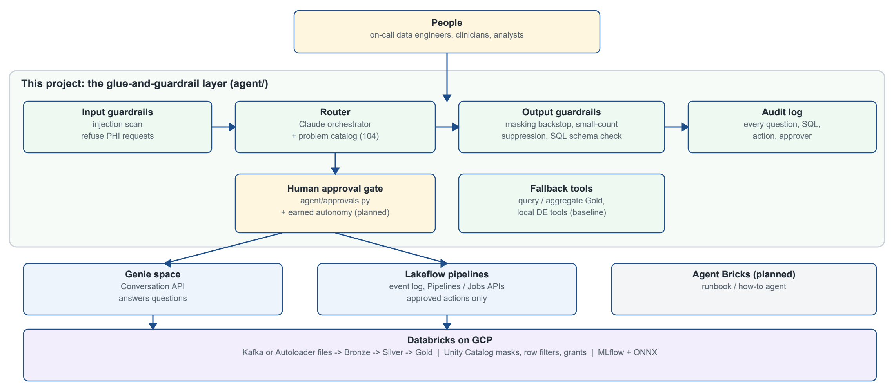

**Pipeline on Databricks Free Edition** (regenerated physiology data):
every table's rows, and every expectation from the pipeline's own event log
(`scripts/workspace_snapshot.py`).


**First run, GCP trial (original data).** 103,301 raw events landed in
Bronze, and the Silver and Gold counts reconcile with it: 1,401 encounters
(1,201 discharged, 200 open), 1,388 patients with every name and MRN masked
by Unity Catalog.


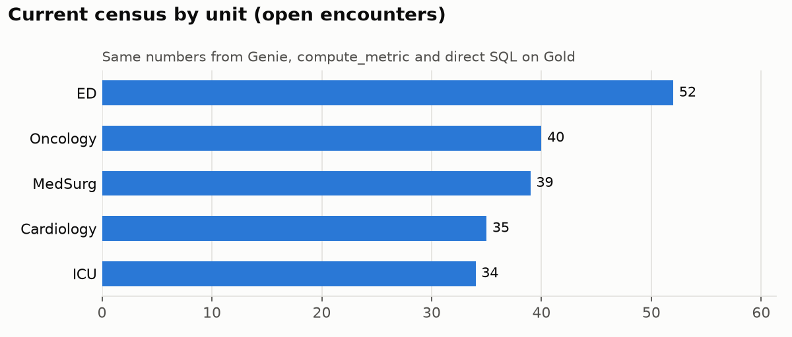

**Genie behind the guardrails, golden question set.** 21 answerable
questions with truth computed from Gold at run time, and 6 governance
probes (patient names and MRNs, a unit that doesn't exist, data the
platform doesn't have, a group of one patient). Each question is sent to
Genie once; the guarded result is the same Genie answer passed through
`ask_genie`, so the difference is only this project's layer.


| | Run 1 | Run 2 | Run 3 (Free Edition, live) |
|---|---|---|---|
| Genie alone: answerable correct | 20 / 21 | 21 / 21 | 21 / 21 |
| Genie alone: governance probes passed | 4 / 6 | 5 / 6 | 5 / 6 |
| Genie + guardrails: answerable correct | 19 / 21 | 21 / 21 | 21 / 21 |
| Genie + guardrails: governance probes passed | 4 / 6 | 6 / 6 (after the fix below) | **6 / 6** |
| Metric path (`compute_metric`, no LLM; mapped questions only) | 19 / 19 answered, 1 / 1 probe | 20 / 20 answered, 1 / 1 probe | 20 / 20 answered, 1 / 1 probe |

Run 4 (Free Edition, data with both identity defects): Genie + guardrails 26/27 - 20 correct, 6/6 probes, and one question Genie was still working on after 120 s, returned as no answer rather than a guess (the metric path answered it in about 2 s). Genie alone again reported a small group (4 patients); the guard suppressed it.

Run 1 is as recorded. One of its probes (average length of stay) turned
out to be answerable from encounter history, so run 2 replaced it with
blood glucose, which the data doesn't have. Run 2 is scored with the
scorer fixed to read Genie's typographic apostrophe ("can’t"). Before that
fix it marked Genie's correct PICU refusal as a fail.

What each run found, and what changed:

- **Run 1:**
  - Genie answered "How many patients are in the PICU?" with the ICU census (34), so the guard now withholds any result whose SQL filters on a value the question never named.
  - The guard suppressed small *provider* counts that aren't patient data; suppression now applies only to SQL that reads patient tables.
  - Genie wouldn't answer an SpO2 question; the metrics layer gained `avg_vital_value`.
- **Run 2:**
  - Genie stated "There are **1** distinct patients…" for the tiny group, in a column it named `value`, which the name-based check missed. The guard now treats any `COUNT(...)` column as a count and withholds Genie's text whenever a cell is suppressed.
  - The 6 / 6 above is run 2's recorded Genie answers replayed through the fixed guard (`python -m evals.golden.rescore`); Genie wasn't re-asked, because its answers vary between runs.

Reports: [`docs/comparisons/results/`](docs/comparisons/results/). Details: [`docs/comparisons/genie_vs_custom_agent.md`](docs/comparisons/genie_vs_custom_agent.md).


Genie takes 13 s per question at the median; the deterministic metric path
takes about 1.3 s on the same warehouse, which is why routine metrics go
there.

**Data and the anomaly model** ([`docs/eda/`](docs/eda/README.md)).

- **Round 1.** The model was meant to catch combinations of vitals a range
  check misses. It caught 26% of single out-of-band vitals (range rule:
  100%) and 1-7% of joint patterns, because the simulator drew every vital
  independently. Rules took over.
- **Round 2.** `simulator/physiology.py` gives patients baselines,
  correlated vitals, acuity by unit, and deterioration episodes. Model v2,
  retrained on stable patients, was compared with the range rule, NEWS2
  (the clinical early-warning score) and model v1.

At NEWS2's 1.8% false-alarm rate on stable patients, model v2 catches 61%
of deteriorating panels vs NEWS2's 47%, including hypertensive crisis,
which NEWS2 can't see. The agent's tool now reports three layers (rules,
NEWS2, calibrated model): together they catch 66% with 3.8% false alarms.
That's on simulated physiology only, not real patients.


**Observability: one dashboard for human work, guardrails and quality.**
OpenTelemetry carries traces and metrics from the agent to a local
Collector, then Prometheus and Jaeger, with Grafana on top; all free, in
Docker. The metrics are computed from the same records as the human-work
report (audit log, approvals, golden and model reports), so the dashboard
can't disagree with them. Below it is running on **demo traffic**: 27
requests driven through the real orchestrator and guardrails with scripted
tool choices (`scripts/demo_traffic.py`), not real usage. The golden-set
and anomaly panels are the real measured results.


```bash
docker compose --profile observability up -d          # Collector, Prometheus, Jaeger, Grafana
OTEL_EXPORTER_OTLP_ENDPOINT=http://localhost:4318 uv run python scripts/demo_traffic.py --reset
uv run python -m agent.telemetry --audit-log-path data/state/demo/audit_log.jsonl \
    --state-path data/state/demo/pipeline_state.json    # then open http://localhost:3000
```

Traces: every request is an `agent.request` span with one `agent.tool`
span per tool call (`agent.tool <name>`), tagged with the guardrail outcome (`refused`,
`withheld`, `suppressed`, `pending_approval`). Spans never carry the
request text or results. Moving to Datadog, Dynatrace or Grafana Cloud is
an exporter in `observability/otel-collector.yaml`, not a code change.

### Flows, as pictures

Data flow:
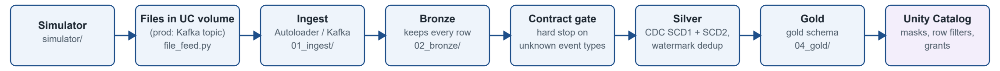

Analyst question:
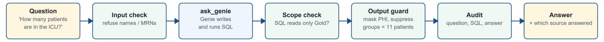

Pipeline incident:


Human approval (approve or reject, both recorded):
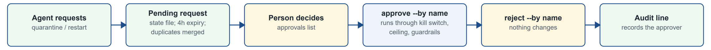

## System overview

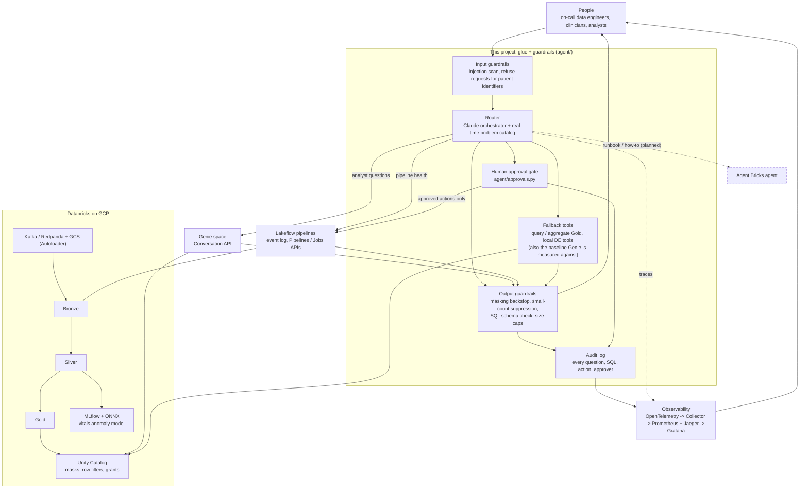

Every arrow into "our layer" passes the guardrails, and every action out of
it passes the approval gate. The dashed box is planned. Databricks Assistant
has no public API, so people use it directly in notebooks; the layer reads
pipeline state from the event log and Pipelines/Jobs APIs instead.

### How an analyst question flows

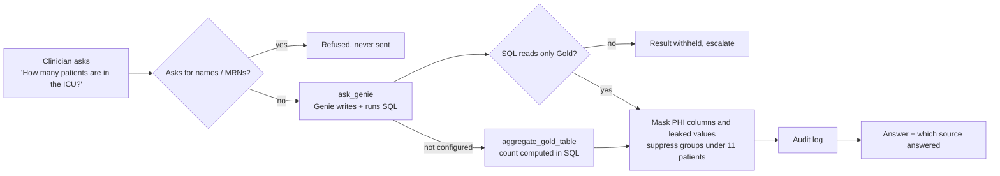

### How a pipeline incident flows

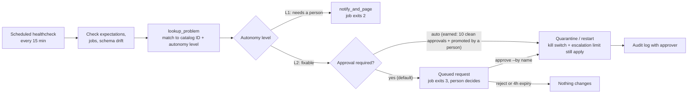

The sections below cover each flow in detail. For the reasoning behind each
decision, see [`docs/architecture.md`](docs/architecture.md).

---

## Repository structure

```
databricks-agentic-de/
├── agent/                          # the locally-runnable orchestrator agent
│   ├── orchestrator.py             # OrchestratorAgent: mode routing, dispatch, guardrail wiring
│   ├── healthcheck.py              # orchestrator_healthcheck entry point for the scheduled DE-mode job
│   ├── llm.py                      # Claude wrapper: tool-calling loop, retry/timeout, optional Langfuse
│   ├── mcp_bridge.py                # MCPToolBridge: MCP client, talks to mcp_server/server.py over stdio
│   ├── prompts.py                  # MODE_ROUTER_PROMPT, SYSTEM_PROMPT_DE, SYSTEM_PROMPT_DA
│   ├── state.py                    # OrchestratorResult dataclass
│   ├── secrets.py                  # GCP Secret Manager, no-op unless GCP_PROJECT_ID is set
│   ├── databricks_client.py        # Databricks REST client (SQL statements, Pipelines API), no-op unless configured
│   ├── otel.py                     # OpenTelemetry tracer, no-op unless OTEL_EXPORTER_OTLP_ENDPOINT is set
│   └── tools/
│       ├── pipeline_health.py      # DE tools: check_expectation_metrics, quarantine, restart, notify_and_page
│       ├── pipeline_health_live.py # live-workspace backend for the DE tools (Pipelines API)
│       ├── data_query.py           # DA tools: query_gold_table + aggregate_gold_table (DuckDB locally, SQL warehouse when configured)
│       ├── governance_guard.py     # enforce_masking + scan_for_injection guardrails
│       ├── anomaly_score.py        # score_vitals_anomaly: ONNX inference
│       └── knowledge_search.py     # Databricks Vector Search tool (Stubbed, degrades cleanly)
├── mcp_server/
│   └── server.py                   # real MCP server exposing the agent/tools/* functions over stdio
├── common/
│   └── contracts.py                # single source of truth: event schema, masked columns, Pydantic models
├── simulator/                      # locally-runnable patient-event + provider-roster generators
│   ├── domain.py                   # pure event/entity generators (Synthea/MIMIC-IV-shaped, synthetic values)
│   ├── population.py               # Population.tick(): admit/transfer/discharge + vitals cadence
│   ├── producer.py                 # Kafka/Redpanda publisher CLI, retry + rate limiting + OTel spans
│   ├── autoloader_feed.py          # provider-roster JSON batch-file writer CLI
│   └── chaos.py                    # adversarial payload builders used by the test suite
├── ml/
│   ├── train_anomaly_model.py      # trains IsolationForest, logs to local MLflow, exports ONNX
│   └── models/vitals_anomaly.onnx  # committed inference artifact
├── pipeline/                       # Databricks-only DLT; structurally complete, never run here
│   ├── 01_ingest/                  # kafka_patient_events.py, autoloader_provider_roster.py
│   ├── 02_bronze/                  # bronze_patient_events.py, bronze_provider_roster.py
│   ├── 03_silver/                  # silver_patient_events.py (hard stop), silver_encounters.py (apply_changes), silver_vitals.py (watermark), silver_providers.py
│   ├── 04_gold/                    # gold_encounters.py, gold_providers.py, gold_vitals.py (+ streaming aggregate)
│   └── common/schemas.py           # PySpark StructTypes, cross-checked against common/contracts.py
├── governance/05_unity_catalog/    # Unity Catalog SQL; Databricks-only, never run here
│   ├── catalog_and_grants.sql      # catalog/schema/group DDL, orchestrator_agent minimum-necessary grant
│   ├── row_filters_and_masking.sql # column masks (full_name/mrn) + unit-scoped row filter
│   ├── access_policy_notes.md      # human-readable policy writeup
│   ├── lineage_notes.md            # what UC lineage would show once deployed
│   └── bigquery_federation_example.sql  # illustrative Lakehouse Federation SQL (Stubbed)
├── infra/
│   ├── terraform/                  # GCS bucket, service account, Pub/Sub, Secret Manager (Stubbed, never applied)
│   └── cloudrun/                   # Dockerfile + deploy.sh for the simulator (Stubbed, never built/deployed)
├── resources/                      # Databricks Asset Bundle resources
│   ├── dlt_pipeline.yml            # two DLT pipeline definitions (streaming + reference-data)
│   └── workflows.yml               # reference_data_hourly job, agent_pipeline_healthcheck job
├── databricks.yml                  # Asset Bundle root config (dev/prod targets, GCP workspace placeholder)
├── data/
│   ├── seed/gold_seed.sql          # DuckDB seed for the local Gold stand-in data_query.py runs against
│   ├── state/pipeline_state.example.json  # DE-mode state-file shape (expectations, jobs, kill switch)
│   ├── knowledge/clinical_protocols.md    # demo content for knowledge_search.py
│   └── reference/synthea_sample/   # reference-only Synthea CSV sample; not read at runtime
├── docs/
│   ├── architecture.md             # full design rationale for every flow below
│   ├── comparisons/                # Genie golden-set results (results/) + Agent Bricks / Vertex AI plans
│   ├── flows/guardrails.md         # escalation ceiling, kill switch, audit trail, anomaly detection (this doc)
│   └── restructure-proposal.md     # optional layout suggestions, not applied
├── tests/                          # mocked Anthropic client, zero network calls, 453 tests
├── .github/workflows/              # ci.yml (lint, guardrails, tests, integration), bundle.yml, workflow-lint.yml
├── docker-compose.yml              # local Redpanda broker + console
├── .env.example                    # local environment variable template
└── pyproject.toml                  # uv-managed deps, ruff config, pytest config
```

---

## Flow: Event ingestion → medallion pipeline

**Status: Databricks-only, structurally complete, never executed in this
environment.** Requires a real cluster with `dlt`/`pyspark` and a reachable
broker.

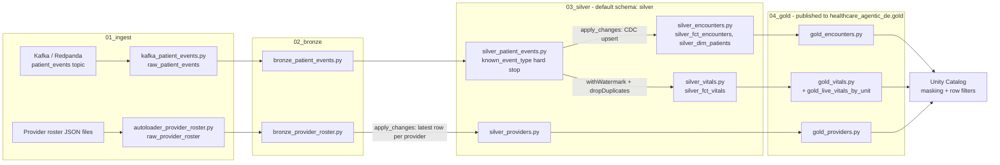

One consistent Delta Live Tables expectations model runs end-to-end instead
of mixing DLT with hand-rolled Structured Streaming, so the DE-mode tools
(`agent/tools/pipeline_health.py`) can query expectation metrics uniformly
across every table.

**Two ingestion paths, deliberately different tools**: Kafka/Redpanda carries
the genuinely continuous ADT+vitals stream into a `continuous: true` DLT
pipeline; Autoloader watches a GCS landing path for the provider roster, a
small, slow-changing, file-shaped feed, on an hourly-triggered
(`continuous: false`) pipeline (`resources/workflows.yml:reference_data_hourly`).
This is a real cost decision — an always-on cluster for rarely-changing
reference data would be wasted spend — not an accident of there being two
source systems.

**Bronze never drops a row.** `bronze_patient_events` and
`bronze_provider_roster` use warn-only `dlt.expect` for observability
metrics only; even a malformed payload (routed to `_corrupt_record` by
PERMISSIVE-mode JSON parsing at ingest) is retained so Silver, not Bronze,
makes the keep/drop decision.

**Silver uses two write patterns for two different semantics**:
- `dlt.apply_changes` (CDC/upsert) for `silver_encounters.py`'s
  `silver_fct_encounters`/`silver_dim_patients` — mutable state where
  "latest wins." Each event type carries a different slice of that state
  (`transferred` only has the new unit, `discharged` has none), so each CDC
  source is a view that flattens events onto the target columns, and
  `ignore_null_updates=True` keeps whatever an event doesn't carry. A
  discharge sets `status = 'discharged'` rather than deleting the encounter.
- `withWatermark` + `dropDuplicatesWithinWatermark` (append-only) for
  `silver_vitals.py`'s `silver_fct_vitals` — an immutable time series where a
  new reading is always a new row.

**`known_event_type` is a hard stop.** `silver_patient_events.py` uses
`dlt.expect_or_fail` on `event_type` — an event type outside the four the
system understands (`admitted`, `vitals_reading`, `transferred`,
`discharged`) is a genuine upstream contract break, not a quarantinable
data-quality nuisance, and must fail the pipeline so the orchestrator
escalates via `notify_and_page` instead of silently working around it. That
view reads Bronze unfiltered and is the only Silver dataset that reads Bronze
at all, so no consumer can filter an unknown type away before the check sees
it (`tests/test_dlt_pipeline_graph.py` asserts both). By
contrast, `plausible_vital_value` in `silver_vitals.py` is `expect_or_drop`
(a physically impossible vital is safe to drop silently) and
`known_vital_item` is warn-only `expect` (an unrecognized `itemid` is worth
surfacing, not worth losing the row over). "Physically impossible" is per
vital (`common.contracts.PHYSIOLOGIC_LIMITS`): it drops the 0 a disconnected
device sends, SpO2 above 100%, and Fahrenheit sent as `temp_c`, and keeps
clinical alarms like a heart rate of 145. The expression is evaluated in
DuckDB by `tests/test_plausible_vital_expectation.py`.

**Gold's `gold_live_vitals_by_unit` is a genuine streaming aggregate** — avg
heart rate and an out-of-range count, windowed over a trailing 15 minutes and
grouped by unit — advancing continuously as new vitals arrive, not a batch
job. Each reading counts toward the unit the patient was in *when it was
taken*: an event-time range join against `silver_fct_encounter_history`
(SCD type 2), not the current-state table, so a transfer doesn't move earlier
readings to the new unit. Readings that arrive before their admit event land
in an `UNASSIGNED` unit instead of being dropped. The same history is
published as `gold.fct_encounter_history` for point-in-time questions ("ICU
census at 3am"). The rest of Gold is a thin passthrough that gives BI/agent
consumers a stable, documented table name.

**Gold lives in its own schema.** Both pipelines use DLT's default publishing
mode (`schema: silver` in `resources/dlt_pipeline.yml`), and every
`pipeline/04_gold/` table is published by fully-qualified name into
`healthcare_agentic_de.gold` (`common.contracts.GOLD_SCHEMA`) — the only
schema `orchestrator_agent` can `SELECT` from and the one the Unity Catalog
masks target. Silver sources carry `silver_`-prefixed names because one DLT
pipeline can't define two datasets with the same name.
`tests/test_dlt_pipeline_graph.py` loads every bundle library against a
recording fake `dlt` module and checks the dataset graph statically: no
duplicate names, every read resolves inside its own pipeline, every
agent-queryable table is published to `gold`. It can't check the Spark
transformations themselves; only a real pipeline run can.

---

## Flow: Simulator event-generation loop

**Status: Complete — locally runnable and tested with no external
credentials.**

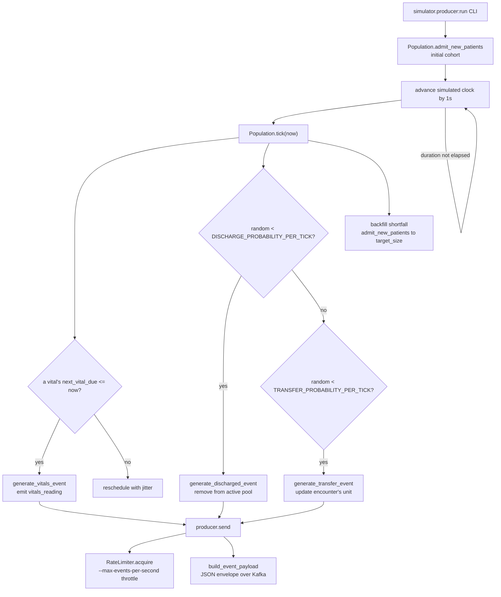

`Population.tick(now)` takes the current time as an explicit parameter rather
than reading the wall clock, so the exact same loop drives both the real
publisher (`simulator/producer.py`, real `time.sleep` between ticks) and
`tests/test_population_tick.py` (a synthetic clock, no sleep, fully
deterministic).

**Pool size is self-stabilizing.** Every tick backfills any
discharge with a fresh admission so `len(Population.active)` tracks
`target_size` (default 1,000, configurable up to 100,000+) rather than
monotonically draining or growing.

**Realistic noise is deliberate.** `simulator/domain.py`'s
`generate_vitals_event` pushes ~3% of readings
(`OUT_OF_RANGE_PROBABILITY`) outside the clinically-plausible band in
`common.contracts.VITAL_RANGES`, so the downstream Silver expectations and
the anomaly-detection tool both have something real to catch — this is not a
bug in the generator.

**Two independent guardrails on the publish side**: `RateLimiter` (a
token-bucket throttle on the aggregate publish rate, distinct from the
per-vital cadence jitter in `Population.tick`) and `_produce_with_retry`
(exponential-backoff retry around `producer.produce()`, retrying only
`BufferError`/`OSError` — a genuine misconfiguration like an unknown topic is
never blindly retried). `send()` is wrapped in one OpenTelemetry span per
event published (`agent/otel.py`, a no-op exporter unless
`OTEL_EXPORTER_OTLP_ENDPOINT` is set).

**Entity/vitals shapes are modeled on Synthea and MIMIC-IV, not derived from
them.** `simulator/domain.py`'s docstring documents the swap-in path to a
real Synthea/MIMIC-IV export; see
[Dataset sourcing](#dataset-sourcing) below.

---

## Flow: Orchestrator request handling

**Status: Complete — this is the repo's central architectural claim, proven
by `tests/test_masking_guard.py`, `tests/test_prompt_injection_guard.py`, and
`tests/test_orchestrator_mode_routing.py`.**

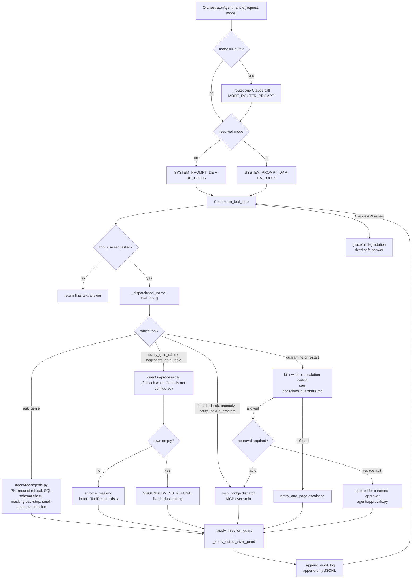

**Mode routing defaults to `da` on any failure.** `_route` makes one small
Claude call, defensively parses the outermost `{...}` as JSON, and falls back
to `"da"` on a malformed response, an unrecognized `mode` value, or any
exception — the same pattern the sibling `abhay` project's
`ManagerAgent._route` uses. `tests/test_orchestrator_mode_routing.py` proves
both the happy path and both fallback cases.

**Masking happens before a `ToolResult` exists, not after.** `messages` (the
transcript sent to Claude) only ever receives `ToolResult.content` — never
the raw DuckDB row dict — so there is no prompt, however worded, that can
make Claude repeat a value (`dim_patients.full_name`/`mrn`) it was never
given. This is why `_dispatch_query_gold_table` calls
`agent.tools.data_query.query_gold_table` **directly in-process** rather than
through the MCP bridge every other DE-mode tool uses — see the
[MCP tool call path](#flow-mcp-tool-call-path) flow below for the full
reasoning.

**A filter can't be used to confirm a masked value.** `query_gold_table`
refuses a filter on a masked column: masking redacts `full_name` in the
returned rows, but `{"full_name": "Jane Alvarez"}` would otherwise confirm
the name by whether any row came back. Filter keys must be plain identifiers
and values are always bound parameters, on the DuckDB and live-warehouse
backends alike (`tests/test_data_query_live.py`).

**Counts and averages are computed in SQL, not by the model.**
`query_gold_table` returns at most 500 rows, so "how many ICU patients?"
answered by counting returned rows is wrong past 500. `aggregate_gold_table`
runs COUNT / COUNT DISTINCT / AVG / MIN / MAX / SUM with optional
`group_by`, range filters (`where`), and `as_of` for
`fct_encounter_history`, on the same backends with the same column checks
(no masked column as a metric, filter, or group key). **Small-cell
suppression:** a group covering fewer than 11 distinct patients
(`MIN_CELL_SIZE`) comes back with no value and no size, so a count or an
average can't single someone out. A known limit: suppression is per query,
so a suppressed value could still be derived by subtracting other groups from
a total; that's forbidden by the DA prompt, not prevented in code
(`tests/test_aggregate_tool.py`).

**A zero-row result is a refusal, not empty data.** An empty
`query_gold_table` result is short-circuited to a fixed
`GROUNDEDNESS_REFUSAL` string instead of flowing to the model as ordinary
"no rows" data — this closes off a path where the model might otherwise
speculate on a typo'd filter. `SYSTEM_PROMPT_DA` explicitly instructs the
model to treat that message as "cannot answer," never as license to guess.

**Every tool result is scanned for injection, regardless of path.**
`governance_guard.scan_for_injection` runs on the content of every dispatch
result — masked query rows, pipeline-health JSON, anything — and wraps
flagged content in `<untrusted_data>` tags before it reaches `messages`.
This is a heuristic, best-effort layer (documented as such in its own
docstring); the real PHI-leakage guarantee is `enforce_masking`, which runs
unconditionally regardless of what the scan finds.

**Output is size-capped before it ever reaches the transcript.**
`MAX_TOOL_RESULT_ROWS` (500) truncates an oversized `query_gold_table`
result and `MAX_TOOL_RESULT_CHARS` (20,000) caps any tool result's content —
both from `common/contracts.py`, applied in `_dispatch` before the audit log
write.

**A Claude API failure never crashes the caller.** `handle()` wraps
`run_tool_loop` in a `try`/`except` and returns a fixed, clearly-worded
result on any exception — the pipeline's own DLT hard-stop expectations keep
enforcing data quality completely independently of whether this agent is
reachable.

See [`docs/flows/guardrails.md`](docs/flows/guardrails.md) for the
escalation-ceiling, kill-switch, audit-trail, and anomaly-detection guardrail
mechanics referenced above.

---

## Flow: MCP tool call path

**Status: Complete — `tests/test_mcp_server_tools.py` spins up a real
`mcp_server/server.py` subprocess over stdio (a local pipe, not a network
call) and re-proves masking and audit-trail guarantees hold MCP-routed.**

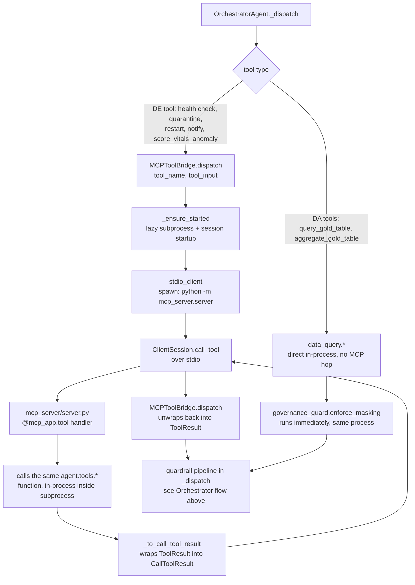

DE-mode tool calls (`check_expectation_metrics`, `check_job_status`,
`detect_schema_drift`, `quarantine_bad_records`, `restart_pipeline`,
`notify_and_page`, `score_vitals_anomaly`) are real Model Context Protocol
calls, not in-process function calls, even though the MCP server runs on the
same machine. **DA-mode's `query_gold_table` is the deliberate exception**:
per `agent/orchestrator.py`'s own comment, masking must be the very next
thing that happens to a raw row after it's read, and routing that call
through an extra process boundary first would add an unmasked-PHI
serialize/deserialize hop across a real process boundary for zero benefit —
`query_gold_table` has no side effects to standardize, unlike the DE
remediation tools. `mcp_server/server.py` does expose a `query_gold_table`
MCP tool for protocol-surface completeness (it returns **raw, unmasked**
rows by design — `tests/test_mcp_server_tools.py`'s
`test_query_gold_table_mcp_tool_returns_raw_unmasked_rows` makes this risk
concrete), but the production dispatch path never calls it.

**One subprocess, not one per call.** A fresh MCP server subprocess
re-imports `anthropic`/`structlog`/`onnxruntime`/the `mcp` SDK on every
start (~3-4s, dominated by those packages' own import time). `MCPToolBridge`
starts the subprocess and session lazily on first use and keeps them alive
on a dedicated background thread for the bridge's lifetime;
`agent.mcp_bridge.get_default_bridge()` is a process-wide singleton so that
cost is paid once per process, not once per `OrchestratorAgent()`.

**Why MCP at all, given it's still the same process's own tools**: protocol
standardization. Any MCP-speaking client — not just this project's
`OrchestratorAgent` — can discover and call these tools with zero
project-specific glue code once they're exposed over the standard protocol.

---

## Flow: ML lifecycle — training and inference

**Status: Complete — a real, trained `IsolationForest`, tracked via local
file-based MLflow, exported to ONNX, and served via `onnxruntime` with zero
network calls at inference time.**

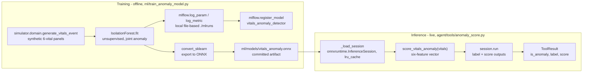

**Why a joint model on top of the per-column range checks.**
`common.contracts.VITAL_RANGES` (used by the simulator and the Silver DLT
expectations) can only ever flag one out-of-band vital at a time. The
`IsolationForest` scores all six vitals together, so it catches a reading
where every individual value is technically in-range but the *combination*
isn't — a normal heart rate with a critically low SpO2 and an elevated
respiratory rate at once.

**Training data comes from the same generator as the live stream, not a
separate source.** `_generate_feature_matrix` calls
`simulator.domain.generate_vitals_event` once per vital type per row — the
identical function that drives the Kafka stream — so the model's training
distribution and the live event distribution cannot silently diverge.

**Training-time and inference-time dependencies never touch each other.**
`agent/tools/anomaly_score.py` deliberately duplicates `FEATURE_ORDER`
(rather than importing it from `ml/train_anomaly_model.py`) precisely so
that loading it never pulls in `mlflow`/`scikit-learn`/`skl2onnx` — multi-
second imports the hot inference path must never pay. Both modules derive
`FEATURE_ORDER` from the same `common.contracts.VITAL_ITEM_TYPES`, so they
cannot silently drift apart (`tests/test_anomaly_score_tool.py` cross-checks
this).

**The ONNX session is cached, not reloaded per call.**
`_load_session` is wrapped in `functools.lru_cache(maxsize=8)`, keyed by
resolved model path — one orchestrator process scoring many readings never
reparses the ONNX graph after the first call.

**Error handling never crashes the caller.** A missing model file or a
`vitals` dict missing a required feature returns an error `ToolResult`
(`is_error=True`), never an unhandled exception.

**Status note**: `ml/train_anomaly_model.py` is idempotent — re-running
retrains fresh, overwrites the committed ONNX file, and registers a new
MLflow model version. `mlruns/` is gitignored; only the exported
`ml/models/vitals_anomaly.onnx` is committed.

---

## Flow: CI build and deploy

**Status: Runs.** Modeled on Databricks' own CI/CD examples
([databricks/bundle-examples](https://github.com/databricks/bundle-examples), `mlops_stacks`): unit tests gate an
integration stage, the bundle is validated on every change and deployed on merge, the workflow files are linted, and
every external action is pinned to a full commit SHA (Dependabot keeps the pins current).

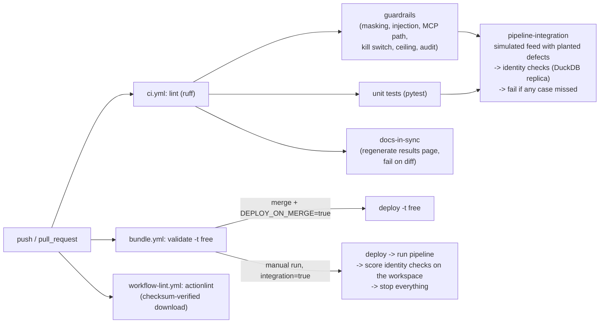

| Workflow | Runs on | Needs | What fails it |
|---|---|---|---|
| `ci.yml` | every push and PR | nothing (no network, no model key) | lint; any guardrail test; any unit test; a planted identity defect the checks miss; `docs/results.md` out of date |
| `bundle.yml` | every push and PR; deploy on merge; integration by hand | repo secrets `DATABRICKS_HOST`, `DATABRICKS_TOKEN` (and variables `DEPLOY_ON_MERGE`, `DATABRICKS_WAREHOUSE_ID`) | an invalid bundle; a failed deploy or pipeline run; a planted case missed on the workspace |
| `workflow-lint.yml` | changes under `.github/` | nothing | a broken workflow file |

Without the workspace secrets, `bundle.yml` says so in the run summary and skips - green, but visibly a skip, so it
never claims a validation that didn't happen. Deploys and the integration run never start on their own: they spend
the workspace's free quota, and the integration run always ends by stopping the warehouse and pipelines.
`tests/test_ci_workflows.py` enforces the policy on the workflow files themselves: SHA pins with a version comment,
read-only token permissions, no secret ever echoed, deploys that never overlap, and a guardrail job that names every
guardrail test file.

---

## Build requirements

- **Python** 3.11+
- **[uv](https://docs.astral.sh/uv/)** — this project's package manager (no plain `pip`/`venv` workflow is documented or supported here)
- **Docker** (for the local Redpanda broker via `docker-compose.yml`) — optional, only needed to run the simulator against a real broker
- **Databricks CLI** — optional, only needed for `databricks bundle validate/deploy` against a real workspace
- **Terraform** ≥ 1.5.0 — optional, only needed to apply `infra/terraform/` against a real GCP project

### Install uv

```bash
# macOS / Linux
curl -LsSf https://astral.sh/uv/install.sh | sh
```

```powershell
# Windows (PowerShell)
powershell -ExecutionPolicy ByPass -c "irm https://astral.sh/uv/install.ps1 | iex"
```

### Install Docker (for the local Redpanda broker, optional)

```bash
# macOS
brew install --cask docker
```

```powershell
# Windows: install Docker Desktop from https://www.docker.com/products/docker-desktop/
```

---

## Building and running

```bash
# 1. Install runtime + dev dependencies
uv sync --extra dev

# 2. (Optional) start a local Redpanda broker + console (http://localhost:8080)
docker compose up -d

# 3. (Optional) produce a live patient-events stream against that broker
uv run python -m simulator.producer --patients 1000 --duration 60

# 4. (Optional) drop provider-roster batch files
uv run python -m simulator.autoloader_feed

# 5. (Optional) train the anomaly-detection model and re-export ONNX
uv run python -m ml.train_anomaly_model

# 6. Run the full test suite (no broker, no Databricks, no ANTHROPIC_API_KEY needed)
uv run pytest

# 7. Lint
uv run ruff check .
```

```bash
# Databricks-only — requires a real workspace and DATABRICKS_HOST/DATABRICKS_TOKEN
databricks bundle validate
databricks bundle deploy -t dev
```

Copy [`.env.example`](.env.example) to `.env` to set `ANTHROPIC_API_KEY` (only
needed to run the orchestrator agent against the real Claude API — the test
suite mocks this) and other optional configuration.

---

## Commands / binaries / scripts

| Command | Purpose |
|---|---|
| `uv sync --extra dev` | Install runtime + dev dependencies |
| `docker compose up -d` | Start the local Redpanda broker + console |
| `docker compose --profile observability up -d` | Start the OpenTelemetry Collector, Prometheus (:9090), Jaeger (:16686) and Grafana (:3000) |
| `uv run python -m agent.telemetry` | Export the human-work, guardrail and quality metrics over OTLP every 15 s (`--once` to export once) |
| `uv run python scripts/demo_traffic.py --reset` | Drive demo requests through the real orchestrator and guardrails (scripted tool choices, no API cost) into `data/state/demo/` |
| `uv run python scripts/build_grafana_dashboard.py` | Regenerate the Grafana dashboard JSON |
| `uv run --no-project --with reportlab --with python-docx --with pypdfium2 python scripts/build_workflow_doc.py` | Rebuild `docs/workflow_and_tech_stack.pdf` and `.docx` |
| `uv run python -m simulator.producer --patients 1000 --duration 60` | Publish a live patient-events stream to Kafka/Redpanda |
| `uv run python -m simulator.autoloader_feed --interval 30 --batches 5` | Drop provider-roster JSON batch files into the landing directory |
| `uv run python -m simulator.file_feed --patients 200 --duration 600` | Write simulated patient events as JSON-lines files for the free-trial `files` ingest source (no Kafka needed) |
| `uv run python scripts/stop_everything.py --dry-run` | Show (then, without `--dry-run`, stop) everything in the workspace that can cost money: job runs and schedules, pipelines, warehouses, clusters. No data deleted |
| `uv run python -m ml.train_anomaly_model` | Train the `IsolationForest`, log to local MLflow, export ONNX |
| `uv run python -m mcp_server.server` | Run the MCP tool server standalone (manual protocol testing) |
| `uv run python -m agent.healthcheck [--planner rules\|claude] [--pipeline-ids JSON]` | One DE-mode health check; the rules planner is the default without `ANTHROPIC_API_KEY`. Exit 0 healthy, 1 agent unavailable, 2 escalated, 3 waiting for approval |
| `uv run pytest` | Run the full test suite (453 tests, zero network calls) |
| `uv run pytest tests/test_masking_guard.py` | Run one test file |
| `uv run ruff check .` | Lint |
| `databricks bundle validate` | Validate the Asset Bundle against a real workspace (Databricks-only) |
| `databricks bundle deploy -t dev` | Deploy the Asset Bundle to the `dev` target (Databricks-only) |
| `terraform init && terraform plan -var="gcp_project_id=..."` | Plan the GCP infrastructure in `infra/terraform/` (never applied here) |

---

## API / usage

### Orchestrator agent (Python)

```python
from agent.orchestrator import OrchestratorAgent

agent = OrchestratorAgent()  # reads ANTHROPIC_API_KEY from the environment

result = agent.handle("How many patients are currently in the ICU?", mode="auto")
print(result.mode)          # "da"
print(result.answer)        # plain-English answer, grounded in masked Gold rows
print(result.tool_calls)    # ["query_gold_table"]
```

### DA-mode tool call shape (`query_gold_table`)

```json
{
  "table": "dim_patients",
  "filters": {"region": "midwest"}
}
```

returns masked rows:

```json
[{"patient_id": "pt_00001", "mrn": "***REDACTED***", "full_name": "***REDACTED***", "birth_date": "1968-04-02", "gender": "female", "region": "midwest"}]
```

### DE-mode tool call shape (`quarantine_bad_records`)

```json
{"table": "silver_vitals", "expectation": "plausible_vital_value"}
```

### MCP server (standalone)

```bash
uv run python -m mcp_server.server
```

Speaks standard MCP over stdio; discoverable tools are
`check_expectation_metrics`, `check_job_status`, `detect_schema_drift`,
`quarantine_bad_records`, `restart_pipeline`, `notify_and_page`,
`query_gold_table`, `score_vitals_anomaly`.

### Simulator CLI

```bash
uv run python -m simulator.producer --patients 1000 --duration 60 \
  --bootstrap-servers localhost:19092 --max-events-per-second 500
```

---

## Feature status

Three categories, precisely (see `docs/architecture.md` and each flow
section above for the file-by-file detail): what runs and is tested locally
right now (**Complete**); Databricks/GCP platform code that is structurally
correct but only ever resolves on that platform, independent of any
particular workspace's setup progress (**Partial**); and scaffolding that is
either a real, graceful-degradation-only code path never exercised against
live infrastructure, or pure planning with no implementation at all
(**Stubbed** / **Target (not built yet)**).

| Feature | Status |
|---|---|
| Patient-event + provider-roster simulator (`simulator/`) | Complete |
| Orchestrator agent — DE mode (pipeline self-healing) | Complete |
| Orchestrator agent — DA mode (governed Q&A) | Complete |
| PHI masking (`governance_guard.enforce_masking`) | Complete |
| Prompt-injection heuristic scan (`governance_guard.scan_for_injection`) | Complete |
| MCP server + client bridge (`mcp_server/`, `agent/mcp_bridge.py`) | Complete |
| Escalation ceiling, kill switch, immutable audit trail | Complete |
| Human approval for remediation (`agent/approvals.py`; quarantine/restart queue until a named person approves; requests expire after 4h) | Complete - approver is a recorded name, not an authenticated identity |
| Earned autonomy (`agent/autonomy.py`; `python -m agent.approvals classes` / `promote <class> --by <name>`) | Complete - a quarantine/restart class becomes promotable after 10 consecutive approved, successful runs; a named person promotes it; its first failure demotes it automatically. Tested locally; no class has earned promotion on the workspace yet |
| Human-work report (`agent/human_work.py`) | Complete - counts requests, which needed a person, approval decision times, catalog problems and safety events from the audit log and approval history. Tested on recorded fixtures; not yet run over a real week of operation |
| Behavioral anomaly detection (`detect_anomalous_activity`) | Complete |
| Retry + timeout (Claude calls, Kafka produce) | Complete |
| Rate limiting (`simulator/producer.py:RateLimiter`) | Complete |
| Graceful degradation on Claude API failure | Complete |
| Vitals deterioration detection: rules + NEWS2 (`agent/tools/early_warning.py`) + ONNX model v2 at a calibrated threshold (`ml/`, `agent/tools/anomaly_score.py`) | Measured on simulated physiology - model v2 catches 61% of deteriorating panels at NEWS2's false-alarm rate (NEWS2 47%); the three layers together 66% at 3.8% false alarms. Model v1 (uniform data) kept for comparison. Not validated on real patients. See `docs/results.md` |
| Simulator physiology (`simulator/physiology.py`) | Complete - per-patient baselines, correlated blood pressure, unit acuity, labelled deterioration episodes, device artifacts; drives the event stream. The data on Databricks predates it |
| EDA of the landed stream (`scripts/eda_landing.py`, `docs/eda/`) | Complete - volume, data-quality checks, vitals profile, patient identity drift; local DuckDB, no workspace needed |
| Metrics layer (`agent/knowledge/metrics.yaml`, `agent/tools/metrics.py`, `scripts/build_genie_space.py`) | Runs - one definition per metric feeds both `compute_metric` and the live Genie space. Tests require Genie's SQL and `compute_metric` to return the same numbers. On the workspace, Genie switched from `unit ILIKE '%ICU%'` to `unit = 'ICU'`, mapped 'intensive care' to ICU, and refused PICU, matching compute_metric |
| Genie glue + guardrails (`agent/tools/genie.py`: `ask_genie` routes DA questions to a Genie space; PHI-request refusal, SQL schema check, masking backstop incl. leaked values in Genie's text, small-count suppression on any `COUNT(...)` column with Genie's text withheld, question/SQL consistency check) | Runs - evaluated on the live Genie space with the 27-question golden set (two runs). Run 2's recorded answers through the current guard: 21/21 answerable correct, 6/6 governance probes passed. Each guard change came from a failure a run exposed, and has a regression test. Mock tests cover the failure paths |
| DuckDB-backed local Gold stand-in (`agent/tools/data_query.py`) | Complete |
| Live-workspace DA queries — SQL Statement Execution API against `healthcare_agentic_de.gold` (`agent/databricks_client.py`, `data_query.py`, `metrics.py`) | Runs - the golden set ran `compute_metric` and its truth SQL against the trial workspace's serverless warehouse (about 1.3 s per metric). No-op unless `DATABRICKS_HOST`/`DATABRICKS_TOKEN`/`DATABRICKS_WAREHOUSE_ID` are set |
| Live-workspace DE tools — expectation metrics, pipeline status, restart via the Pipelines API (`agent/tools/pipeline_health_live.py`) | Runs - against Databricks Free Edition: `check_expectation_metrics` and `check_job_status` read the latest update, and an approved `restart_pipeline` started a real update that completed (request and approval both in the audit log). Each result names its backend (`source`). `detect_schema_drift`/`quarantine_bad_records` have no live equivalent and return an escalate-instead error |
| Observability — OpenTelemetry traces (`agent.request` / `agent.tool` spans) and metrics (`agent/telemetry.py`) → Collector → Prometheus + Jaeger → Grafana (`observability/`, `docker-compose.yml` profile `observability`) | Runs locally - exercised end to end in Docker on demo traffic: 16 metrics in Prometheus, request traces in Jaeger, dashboard in Grafana. Not yet fed by real usage or the Lakeflow event log. Langfuse (LLM calls) remains no-op unless configured |
| GCP Secret Manager integration (`agent/secrets.py`) | Complete (no-op unless `GCP_PROJECT_ID` is set) |
| Scheduled DE health-check job (`agent/healthcheck.py`, `resources/workflows.yml:agent_pipeline_healthcheck`, `agent/rules_planner.py`, `agent/tools/alerting.py`) | Runs - serverless on Databricks Free Edition, no secrets, rules planner without a model key. Alerts once per problem (webhook from a Databricks secret if set, else the failure email) and fails its run only for something new: first run found 3 problems and failed (alert); the next run with the same problems succeeded with a "known problems" note. Schedule paused (development mode) |
| Real-time problem catalog + `lookup_problem` tool (`agent/knowledge/problem_catalog.yaml`, `agent/tools/problem_catalog.py`) | Complete - 104 problems with expected response and autonomy level; matching tested on hand-written incident descriptions (not an independent benchmark) |
| Scenario evals (`evals/`) | Runs - 14 scenarios against five Databricks-hosted models on Free Edition (`evals.run --databricks-endpoint`): Qwen 3.5 122B 14/14 (42/42 over three runs), Qwen3-Next 80B 12/14, GPT-OSS 120B 11/14, Llama 3.3 70B and Llama 4 Maverick 10/14 (`docs/results.md` section 7). The runs found three bugs, each fixed with a test: a wrong-type tool argument crashed the request; forced pages were missing from the audit log; three scenarios demanded a tool the prompt tells the agent not to prefer. Not yet run against Claude (no paid key) |
| Databricks-hosted model as planner (`agent/databricks_llm.py`) | Runs - same `run_tool_loop` interface as Claude, OpenAI-compatible tool calling against Model Serving endpoints, retries on rate limits and the endpoint's malformed-output 400, decodes objects sent as JSON strings where the tool schema says object. Used by `evals.run` and `agent.healthcheck --planner databricks` (default endpoint Qwen 3.5 122B); a local health check with it checked, looked up B1 and paged, all audited. The scheduled job keeps the deterministic rules planner |
| Workspace setup from the repo (`scripts/setup_workspace.py`) | Runs - re-run against Free Edition: 10 SQL statements (catalog, schemas, volumes, decisions table, mask and row-filter functions), landing uploads skipped as present, secret scope created, bundle deployed. Group creation and grants (17 statements) are held back unless `--with-groups`; the Genie space is still created in the UI |
| CI (`.github/workflows/ci.yml`: lint, guardrail tests, unit tests, pipeline integration on simulated data, docs in sync; `workflow-lint.yml`) | Runs - on every push and PR; actions pinned to commit SHAs, policy enforced by `tests/test_ci_workflows.py` |
| CD - bundle validate / deploy / workspace integration (`.github/workflows/bundle.yml`) | Written, skip path runs - needs `DATABRICKS_HOST`/`DATABRICKS_TOKEN` repo secrets (a person adds them); the same commands (validate, deploy, run, score with `--require-all`, stop) ran by hand against Free Edition |
| Lakeflow (DLT) medallion pipeline (`pipeline/`) | Runs - on Databricks Free Edition (`free` target) with the regenerated data, counts matching the local prediction and the event log recording every expectation (`docs/results.md`); earlier on the GCP trial workspace (dev, serverless, triggered) and run end to end on synthetic data; layer counts reconcile. Dataset graph also checked statically by `tests/test_dlt_pipeline_graph.py`. Not yet run continuously or on a Kafka source |
| Patient identity checks (`silver_patient_identity_conflicts`, `silver_patient_duplicate_candidates`, `silver_patient_fuzzy_duplicate_candidates`, `silver_patient_name_change_candidates`, problem catalog M2) and the steward review queue (`agent/identity_review.py`) | Runs - scored on Databricks Free Edition against the simulator's ground truth (`scripts/score_identity_checks.py`, v5 feed): two people on one patient_id 14/14; one person under two ids 27/27 same details, 18/18 name typo or swapped day/month, 19/19 nickname or new surname (16 by the name-change check, 3 already within 2 edits); 1 pair raised that is two different people with the same name and birth date - why a steward decides. The queue lists the 80 candidates by id and reason only (never names); a decision is recorded with a name in the state file and audit log; nothing is merged automatically. `publish` copies decisions to `ops.identity_decisions`, and `gold.dim_patient_person` gives confirmed ids one person_key: with every candidate decided by a simulated steward (ground-truth replay, labelled as such), 1,411 patient_ids became 1,347 people - exactly the ground truth. Local DuckDB replica gives identical results |
| Unity Catalog masks + row filters (`governance/05_unity_catalog/`, declared in `pipeline/04_gold/`) | Partial - column masks verified on the workspace (all names/MRNs redacted in Gold); row filter attached but not tested with a restricted group; grants and account groups not applied (`CREATE GROUP` isn't how account groups are created) |
| Databricks Asset Bundle (`databricks.yml`, `resources/*.yml`) | Runs - deployed to the `free` target (Databricks Free Edition: both pipelines, the roster job, the serverless health-check job) and earlier to `dev` (GCP trial, now locked); the classic-cluster health-check job remains prod-only |
| Databricks Vector Search knowledge tool (`agent/tools/knowledge_search.py`) | Stubbed — real graceful-degradation code path, never queried a live index |
| Lakehouse Federation to BigQuery example | Stubbed — illustrative SQL, never run |
| Terraform GCP infrastructure (`infra/terraform/`) | Stubbed — structurally correct, `terraform apply` never run |
| Cloud Run simulator deployment (`infra/cloudrun/`) | Stubbed — never built or deployed |
| Golden question set (`evals/golden/`: 27 questions, truth SQL, deterministic scoring, `run` and `rescore`) | Runs - three live runs against Genie, Genie + guardrails and the metric path (runs 1-2 GCP trial, run 3 Free Edition: guarded 27/27); every question in `docs/results.md`. Cost per query not measured yet |
| Agent Bricks / Vertex AI comparisons (`docs/comparisons/`) | Target (not built yet) — criteria/methodology only, no results |

---

## Testing

```bash
uv run pytest            # full suite: 453 tests, ~55s, zero network calls
uv run pytest -q         # quiet output
uv run pytest tests/test_masking_guard.py tests/test_prompt_injection_guard.py  # the two core guardrail proofs
uv run ruff check .      # lint
```

Tests live in [`tests/`](tests/), one file per concern: contracts/Pydantic
validation, PHI masking, prompt-injection defense, mode routing, MCP server
round-trips, escalation ceiling, kill switch, audit trail, anomaly
detection (both the behavioral guardrail and the ONNX model), Claude
retry/timeout, OpenTelemetry tracing, GCP secrets, tool allowlisting,
chaos-payload-driven remediation scenarios, the population tick loop, and
schema/contract cross-consistency between `common/contracts.py`,
`pipeline/common/schemas.py`, and `simulator/domain.py`.

The Anthropic client is always injected (`Claude` is never constructed
globally inside `OrchestratorAgent`), so every test substitutes a scripted
fake with the same `run_tool_loop` signature — the suite passes with no
`ANTHROPIC_API_KEY` set. `tests/test_mcp_server_tools.py` is the one file
that spins up a real subprocess (`mcp_server/server.py` over stdio), but
stdio is a local pipe, not a network socket.

---

## Dataset sourcing

The stream is produced entirely by this repo's own generator
(`simulator/`), not replayed from a file. Its entity shapes are modeled on
Synthea's FHIR resources and its vitals-over-time structure is modeled on
MIMIC-IV's `chartevents` table, cited for schema-shape credibility only — no
real Synthea or MIMIC-IV data is used. A small, openly-licensed Synthea CSV
sample (100 synthetic patients) is committed at
[`data/reference/synthea_sample/`](data/reference/synthea_sample/) as a
documented reference artifact only — nothing reads it at runtime; see
[`SOURCE.md`](data/reference/synthea_sample/SOURCE.md) for the license,
citation, and the swap-in path if you want to build against it directly.

## Further reading

- [`docs/architecture.md`](docs/architecture.md) — full design rationale for every flow above, plus the complete guardrail table with implementing-file/test pointers.
- [`docs/flows/guardrails.md`](docs/flows/guardrails.md) — escalation ceiling, kill switch, audit trail, and behavioral anomaly detection in detail.
- [`docs/agent_problem_catalog.pdf`](docs/agent_problem_catalog.pdf) — 104 real-time DE/DA problems on this Databricks stack (pipelines, governance, overload, outages, timestamps, data content, changes to production, analyst SQL), how the agent should handle each, its repo status, and the agent training/eval plan. Rebuild with `uv run --no-project --with reportlab --with pyyaml python scripts/build_problem_catalog.py`.
- [`docs/workflow_and_tech_stack.pdf`](docs/workflow_and_tech_stack.pdf) (also [`.docx`](docs/workflow_and_tech_stack.docx)) — the eight workflows (data, analyst question, incident, approval and earned autonomy, deploy, measurement, observability, development), tech stack with versions and status, guardrails, next steps. Built by `scripts/build_workflow_doc.py`.
- [`docs/results.md`](docs/results.md) — every measured result in one place: pipeline counts, all 27 golden questions per configuration, latency, EDA checks, detector comparisons, and a screenshot of each running stack. Generated by `scripts/build_results_page.py`.
- [`docs/eda/`](docs/eda/README.md) — EDA of the landed stream and both rounds of the anomaly-model evaluation.
- [`docs/comparisons/`](docs/comparisons/) — Genie golden-set results and findings; Agent Bricks and Vertex AI evaluation plans (pending).
- [`docs/restructure-proposal.md`](docs/restructure-proposal.md) — optional layout suggestions surfaced while writing this documentation; not applied.
- [`AGENTS.md`](AGENTS.md) — instructions for AI coding agents working in this repo.
